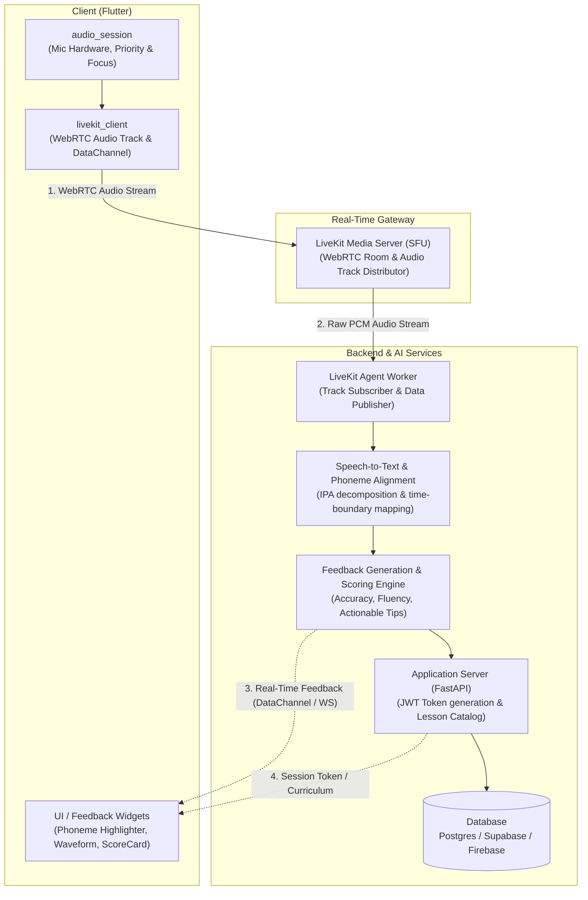

# 🎙️ PronounceAI - Real-Time Pronunciation & Accent Coach

PronounceAI is an ultra-low-latency pronunciation and accent coaching application built on **Flutter**, **LiveKit WebRTC SFU**, and **Python (FastAPI + Phoneme Forced Alignment)**.

---

## 🏗️ Core Architecture Overview



---

## 📁 Repository Structure

| Layer | Recommended Technology | Purpose & Implementation |
| :--- | :--- | :--- |
| **Mobile Frontend** | Flutter (Dart) | Cross-platform UI with high rendering performance ([`main.dart`](file:///C:/Users/avina/.gemini/antigravity/scratch/pronounce-ai/client/lib/main.dart)) |
| **Audio Capture** | `audio_session` | Microphone configuration, sample rates (16 kHz / 48 kHz mono), `gainTransientExclusive` focus, and OS clipping prevention ([`audio_session_manager.dart`](file:///C:/Users/avina/.gemini/antigravity/scratch/pronounce-ai/client/lib/core/audio_session_manager.dart)) |
| **Real-Time Streaming** | LiveKit (`livekit_client`) | Ultra-low latency WebRTC streaming and DataChannel messaging ([`livekit_service.dart`](file:///C:/Users/avina/.gemini/antigravity/scratch/pronounce-ai/client/lib/core/livekit_service.dart)) |
| **Speech Assessment** | Azure Speech Service / Whisper + CTC | Phoneme-level accuracy, fluency, completeness, and prosody scores ([`azure_speech.py`](file:///C:/Users/avina/.gemini/antigravity/scratch/pronounce-ai/backend/app/services/azure_speech.py), [`scoring_engine.py`](file:///C:/Users/avina/.gemini/antigravity/scratch/pronounce-ai/backend/app/services/scoring_engine.py)) |
| **Backend API** | FastAPI (Python) | Ephemeral room tokens (`GET /api/v1/rooms/join-token`), session management, and curriculum catalog ([`rooms.py`](file:///C:/Users/avina/.gemini/antigravity/scratch/pronounce-ai/backend/app/routers/rooms.py)) |
| **Database & Auth** | Supabase (Postgres) | Relational storage for sessions, profiles, and phoneme scores with RLS ([`schema.sql`](file:///C:/Users/avina/.gemini/antigravity/scratch/pronounce-ai/supabase/schema.sql)) |
│   ├── app/
│   │   ├── config.py                # Environment configuration
│   │   ├── main.py                  # FastAPI application entrypoint
│   │   ├── livekit_agent.py         # LiveKit audio worker subscribing to PCM
│   │   ├── services/
│   │   │   ├── livekit_token.py     # Token minting with publish/subscribe grants
│   │   │   ├── stt_alignment.py     # Phoneme forced alignment engine (IPA)
│   │   │   └── scoring_engine.py    # Scoring & pedagogical coaching logic
│   │   └── routers/
│   │       ├── exercises.py         # Pronunciation exercises & IPA hints
│   │       ├── sessions.py          # Session initiation & tokens
│   │       └── health.py            # Health verification
│   ├── requirements.txt             # Python dependencies
│   ├── Dockerfile                   # Backend container
│   └── .env.example
├── client/                          # Flutter Mobile & Desktop App
│   ├── lib/
│   │   ├── main.dart                # App entry point & theme
│   │   ├── core/
│   │   │   ├── audio_session_manager.dart # Audio focus & low-latency mic setup
│   │   │   └── livekit_service.dart # WebRTC audio stream & data channel client
│   │   ├── models/
│   │   │   ├── exercise.dart        # Target phrases, IPA targets, hints
│   │   │   └── phoneme_feedback.dart# Real-time phoneme score models
│   │   ├── widgets/
│   │   │   ├── phoneme_highlighter.dart # Color-coded interactive phonetic breakdown (tap to inspect)
│   │   │   ├── articulatory_sheet.dart  # 2D sagittal vocal tract & tongue posture sheet
│   │   │   ├── prosody_ribbon.dart      # Dual-track pitch contour vs native reference
│   │   │   ├── radial_gauge.dart        # Multi-arc concentric circular scoring dials
│   │   │   ├── audio_visualizer.dart    # Animated live sound waveform
│   │   │   └── score_card.dart          # Overall metrics & AI coach advice card
│   │   └── screens/
│   │       └── practice_screen.dart # Interactive practice interface
│   ├── pubspec.yaml                 # Flutter dependencies
├── docker-compose.yml               # Local LiveKit SFU + Backend stack
└── README.md
```

---

## ⚡ Quickstart

### 1. Run LiveKit SFU & Backend (Docker)
```bash
docker compose up -d
```
The LiveKit server will be running on `ws://localhost:7880` with default keys (`devkey` / `secret`), and the FastAPI server will be live on `http://localhost:8000`.

### 2. Run Backend Locally (Without Docker)
```bash
cd backend
python -m venv venv
venv\Scripts\activate       # On Windows
pip install -r requirements.txt
uvicorn app.main:app --reload --port 8000
```

To run the LiveKit real-time agent:
```bash
python -m app.livekit_agent dev
```

### 3. Run Flutter Client
```bash
cd client
flutter pub get
flutter run
```

---

## 🎯 How the Real-time Feedback Loop Works
1. **Focus & Capture**: `audio_session` configures the device hardware for low-latency speech measurement.
2. **WebRTC Ingestion**: `livekit_client` creates a high-quality audio track (with echo cancellation & noise suppression) and publishes it to the LiveKit SFU room.
3. **PCM Stream Ingestion**: The backend LiveKit agent subscribes to the audio track and buffers raw PCM audio frames.
4. **Phoneme Alignment**: `PhonemeAlignmentService` breaks the speech down into individual phoneme units, computing alignment timestamps and confidence scores.
5. **Real-time Feedback**: `ScoringEngine` compares against the expected IPA target, produces an accuracy/fluency score, and publishes the result back via LiveKit's **Data Channel**.
6. **Reactive Display**: The Flutter `PhonemeHighlighterWidget` updates live with green (accurate), amber (accent variation), and red (mispronounced) highlights.
